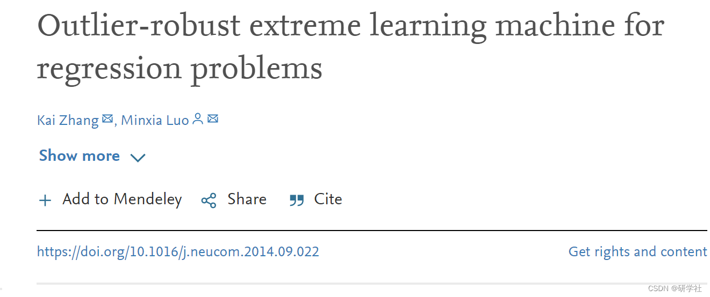
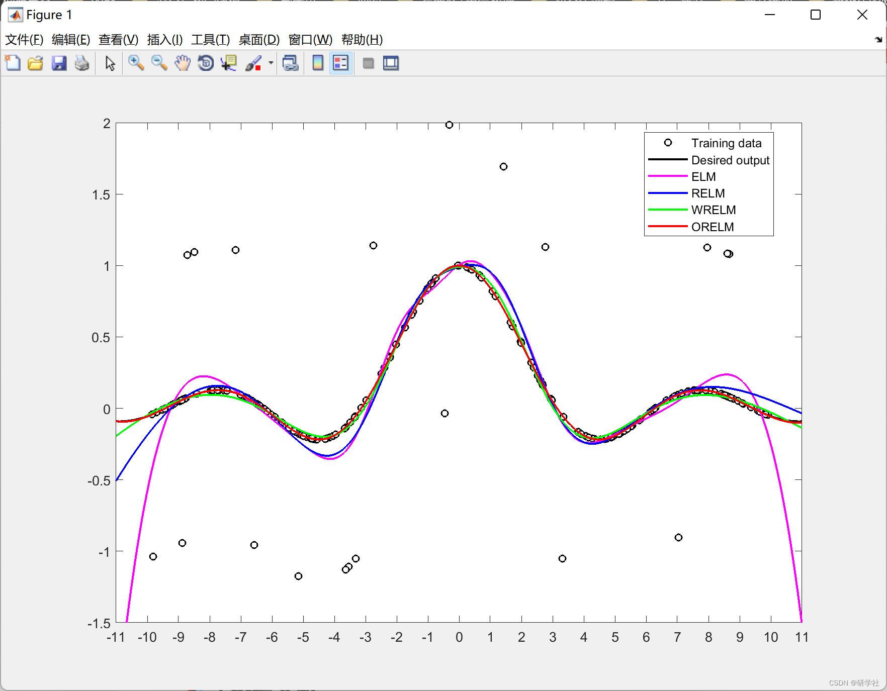
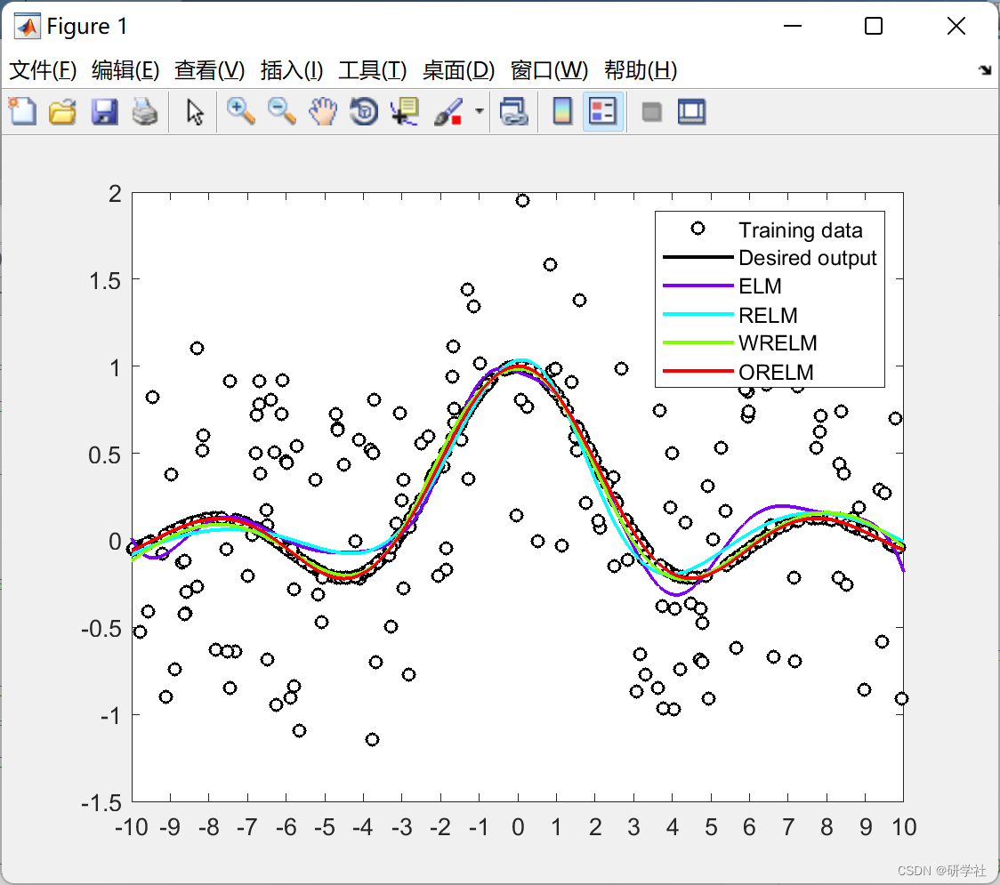

# ORELM (Outlier Robust Limit Learning Machine) for Regression Problems - Matlab Code Implementation

💥💥💞💞 Welcome to this blog❤️❤️💥💥
🏆 Bloggers' Advantages: 🌞🌞🌞 The content of the blog strives for rigorous thinking and clear logic, convenient for readers.
⛳️ Mantra: "A journey of a thousand miles is begun with a single step." 1 Overview📚2 Run results🎉3 References🌈4 MATLAB Code Implementation
Edited by
The extreme learning machine (ELM) is one of the most useful techniques in machine learning, widely recognized for its uniquely rapid learning capability. Particularly, it is generally believed that ELM has a speed advantage while achieving satisfactory results. However, the presence of outliers can lead to unreliable ELM models. In this paper, we address the robustness of ELM in regression problems against outliers. Based on the sparsity characteristics of outliers, we propose an outlier-robust ELM, where the 1-norm loss function is used to enhance robustness. Specifically, the fast and accurate enhanced Lagrange multiplier method is adopted to ensure effectiveness and efficiency. Through function approximation experiments and some practical applications, our proposed method not only retains the advantages of the original ELM but also shows significant and stable accuracy in handling outlier data.
📚2 Run results​ Edited by
Part of the code:
nn.hiddensize = 20;
method      = {'ELM','RELM','WRELM','ORELM'};
type       = {'regression','classification'};
nn.type     = type{1};
nn.inputsize   = size(traindata,1);
nn.activefunction = 's';
nn.orthogonal  = false;
fprintf('      method      | Training Acc. |  Testing Acc. | Training Time \n');  
%%%------------------------------------------------------------------------  
%%% ELM / Original ELM  
%%%------------------------------------------------------------------------  
nn.method    = method{1};  
nn        = elm_initialization(nn);  
[nn, acc_train] = elm_train(traindata, trainlabel, nn);  
[nn1, acc_test] = elm_test(testdata, testlabel, nn);  
fprintf('   %19s   |   %.3f   |   %.5f   |   %.5f   \n',nn.method,acc_train,acc_test,nn.time_train);  
%%%------------------------------------------------------------------------  
%%% RELM / Regularized ELM  
%%%------------------------------------------------------------------------  
nn.method    = method{2};  
nn        = elm_initialization(nn);  
nn.C       = 0.0001;  
[nn, acc_train] = elm_train(traindata, trainlabel, nn);  
[nn2, acc_test] = elm_test(testdata, testlabel, nn);  
fprintf('   %19s   |   %.3f   |   %.5f   |   %.5f   \n',nn.method,acc_train,acc_test,nn.time_train);  
%%%------------------------------------------------------------------------  
%%% WRELM / Weighted Regularized ELM  
%%%------------------------------------------------------------------------  
nn.method    = method{3};  
nn.wfun     = '1';  
nn.scale_method = 1;  
nn        = elm_initialization(nn);  
nn.C       = 2^(-20);  
[nn, acc_train] = elm_train(traindata, trainlabel, nn);  
[nn3, acc_test] = elm_test(testdata, testlabel, nn);  
fprintf('   %19s   |   %.3f   |   %.5f   |   %.5f   \n',nn.method,acc_train,acc_test,nn.time_train);  
%%%------------------------------------------------------------------------  
%%% ORELM / Outlier-Robust ELM  
%%%------------------------------------------------------------------------  
nn.method    = method{4};  
nn        = elm_initialization(nn);  
nn.C       = 2^(-40);  
[nn, acc_train] = elm_train(traindata, trainlabel, nn);  
[nn4, acc_test] = elm_test(testdata, testlabel, nn);  
fprintf('   %19s   |   %.3f   |   %.5f   |   %.5f   \n',nn.method,acc_train,acc_test,nn.time_train);  
%%%------------------------------------------------------------------------  
%%% Plot  
%%%------------------------------------------------------------------------  
figure(1);  
plot(traindata,trainlabel,'o','MarkerSize',5,'MarkerFaceColor','w','MarkerEdgeColor','k','linewidth',1);  
hold on;  
plot(testdata,testlabel,'k','linewidth',1.5);  
nb_topics = 4;  
cmap   = hsv(nb_topics);  
cmap   = flip(cmap,1);  
Acc_test = zeros(1,nb_topics);  
for i = 1:nb_topics  
%hold on;  
Acc_test(i) = eval(['nn',num2str(i),'.acc_test']);  
plot(testdata,eval(['nn',num2str(i),'.testlabel']),'color',cmap(i,:),'linewidth',1.5);  
end  
axis([-10,10,-1.5,2]);  
set(gca,'XTick',-10:1:10)  
legend1 = legend([{'Training data'},{'Desired output'},method]);  
name = 'fig1';  
print('-depsc','-painters',[name,'.eps']);  
🎉3 References
🌈4 Matlab code implementation

## Images

<!-- PAYMENT_BLOCK -->

## Get this dataset

- Payment link (Stripe): [Buy now](https://buy.stripe.com/3cs8yP7sY87d0vu9AB)
- Payment QR code: 

<!-- /PAYMENT_BLOCK -->
